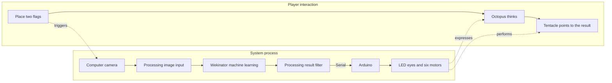

# Robot-Arm-Project
CPS Group 21 - Paul the Octopus
## System Architecture

The interaction begins at the flag game board. After the player places two flag cards, the octopus shows a short thinking response through its LED eyes and tentacles, then points toward the predicted winner.



Behind the interaction, the camera captures the two flags. Processing prepares the image data and sends it to Wekinator, where the machine-learning model predicts the match result. Wekinator continuously returns a class and its probabilities. Processing filters these predictions so that each round produces one stable command.

The confirmed class and the two highest probabilities are sent to Arduino through serial communication. The class determines the final pointing direction, while the difference between the two probabilities represents the model's confidence and affects the thinking behaviour.

Arduino converts the decision into LED expressions and tentacle movements. The two tentacles use six motors in total. Each tentacle has one motor for base rotation, one for the main body, and one for the tip. Together, they perform the thinking, hesitation, and pointing movements.

The following sections explain each part of the system in more detail.

## Software Design

The system separates camera capture, machine learning, communication, and robot control into independent components. Each component can be tested separately.

```text
Camera
  ↓
Processing: crop and downsample two flag images
  ↓  OSC /wek/inputs, port 6448
Wekinator: four-class KNN model
  ↓  OSC /wek/outputs and /Match-Result, port 12000
Processing: result filtering and serial bridge
  ↓  USB serial, 9600 baud
Arduino: input validation and robot-arm control
```

### Main components

| Component | File | Responsibility |
| --- | --- | --- |
| Camera input | `Camera_to_Wekinator_40x30/Camera_to_Wekinator_40x30.pde` | Captures regions A and B and converts them into fixed-size RGB inputs |
| Machine learning | `Wekinator FlagMatch AB.app` and `FlagMatch_AB_4Class/` | Stores the training data and KNN model and predicts the result for each flag pair |
| Arduino bridge | `processing_osc_to_arduino/processing_osc_to_arduino.pde` | Receives classes and probabilities, manages each round, and sends one confirmed result through serial |
| Robot control | `../Archive_Obsolete/RobotArm/RobotArm.ino` | Validates serial data and controls the Base, X, and Y servos |

The bridge without round-state filtering is stored in `processing_osc_to_arduino_backup/`. It can be used to test direct communication between Wekinator and Arduino.

### Camera input

The camera view contains two horizontal capture regions:

- Region A contains the left flag.
- Region B contains the right flag.
- Both regions use a 2:1 aspect ratio and are not stretched.
- Each region is downsampled to 50 × 25 pixels.
- Each pixel contributes red, green, and blue values.

Each flag produces:

```text
50 × 25 × 3 = 3,750 inputs
```

The two regions are combined into one OSC message:

```text
3,750 + 3,750 = 7,500 inputs
```

Values 1–3,750 belong to A, and values 3,751–7,500 belong to B. Wekinator distinguishes the two images by their fixed positions in the input array.

### Communication

The camera sketch sends image data to Wekinator:

```text
Address: /wek/inputs
Port: 6448
Values: 7,500 floats
```

Wekinator returns:

```text
/wek/outputs    Predicted class
/Match-Result   Class probabilities
Port: 12000
```

The Processing bridge sends one CSV line to Arduino:

```text
<class>,<top_probability>,<second_probability>
```

Example:

```text
2,0.7426,0.1831
```

This represents Class 2, with a top probability of 0.7426 and a second-place probability of 0.1831. Processing and Arduino both use a baud rate of 9600.

### Round state control

Wekinator evaluates every camera frame, so small changes in lighting, position, or camera noise can make the result switch between classes. Sending every frame directly to Arduino could trigger repeated or conflicting movements.

The Processing bridge uses the following state sequence:

```text
Class 1 remains stable for 500 ms
  ↓
The next round is armed
  ↓
Class 2–4 is first detected
  ↓
Wait 2 seconds for the player to place both flags
  ↓
Record predictions for 2 seconds
  ↓
Select the most frequently detected class
  ↓
Send one result
  ↓
Lock until Class 1 is detected again
```

During the two-second observation period, Processing counts the occurrences of Classes 2–4. The most frequent class becomes the final result. The bridge also averages the top and second-place probabilities from the samples associated with that class.

After sending the result, the bridge ignores further predictions until Class 1 remains stable again. Removing both flags therefore ends the current round and enables the next one.

The current Arduino program also waits three seconds before moving. With both delays enabled, the robot responds about seven seconds after the first non-empty prediction.

## 6. Machine Learning

### Problem definition

The project uses a four-class classifier:

| Class | Label |
| --- | --- |
| 1 | Nothing / empty board |
| 2 | A beats B |
| 3 | B beats A |
| 4 | Draw |

The model maps a pair of flag images directly to a match result. It does not identify each country separately or query an external football database.

For matches with a winner, both left-right arrangements are recorded. If the winning flag is in region A, the sample is labelled Class 2. After swapping the flags, it is labelled Class 3. A draw remains Class 4 in both arrangements.

### Training data

When `Start Recording` is active, every captured frame becomes an independent training example. Each recording session contains about 30 frames, with a possible difference of one or two frames because recording is stopped manually.

Using a similar number of frames for each matchup prevents one recorded matchup from contributing much more data than another. It does not make the four output classes equal because the dataset contains different numbers of wins and draws.

The current dataset contains 14,070 examples:

| Class | Examples |
| --- | ---: |
| Class 1 | 30 |
| Class 2 | 5,887 |
| Class 3 | 5,877 |
| Class 4 | 2,276 |
| **Total** | **14,070** |

Recording a static scene produces many nearly identical examples. This increases the dataset size but provides limited variation. When time allows, training should include changes in:

- flag position;
- camera distance;
- lighting;
- screen illumination;
- background and shadows.

Both flags should remain fully inside their capture regions.

### Model

Wekinator uses a K-Nearest Neighbours classifier:

```text
K = 101
```

The model finds the 101 closest training examples and predicts a class from their labels.

A single recording produces about 30 highly similar frames. With a small K, one recording can dominate the local neighbourhood and produce probabilities close to 0% or 100%. Setting K above 30 is a practical way to reduce this effect, although it is not a mathematical requirement.

K=101 is roughly equivalent to more than three 30-frame recording batches. It produces more cautious results when the nearest samples come from several recordings. A larger K cannot correct duplicated data, class imbalance, or missing lighting and position variations.

### Understanding class probabilities

Wekinator’s class probabilities are based on the labels of nearby KNN examples. They are not calibrated probabilities and should not be interpreted as the real-world chance of a team winning.

For a genuinely identical input, KNN should return the same result. If the probability changes while the scene appears still, the input pixels are usually changing because of camera noise, automatic exposure, shadows, or small movements. The model does not accumulate confidence over time.

The total number of examples in a class also does not guarantee that the class will win every prediction. KNN mainly depends on the examples closest to the current input.

### Inference stabilisation

The model processes individual frames and has no built-in concept of a complete game round. The Processing bridge adds this temporal structure:

1. Class 1 must appear before a new round can begin.
2. The system waits two seconds for flag placement.
3. It records predictions for two seconds and selects the most frequent class.
4. It sends one result and ignores further predictions until Class 1 returns.

Wekinator performs frame-level classification, Processing converts the predictions into one stable command, and Arduino validates the command before moving the robot arm.

### Limitations

The model uses low-resolution RGB pixels, so lighting, reflections, shadows, background changes, and flag position can affect its output. It learns pixel similarity rather than flag identity, country information, or football rules.

The dataset is imbalanced, and evaluation currently relies on live observation. There is no separate test set or confusion matrix. The displayed probabilities are suitable for interaction and motion control, but not as calibrated confidence scores or real match predictions.

Possible improvements include:

- balancing the four classes;
- reducing duplicate frames;
- recording more lighting, distance, and position variations;
- reserving some flag pairs for testing;
- measuring errors with a confusion matrix;
- adding colour normalisation or more stable visual features.
