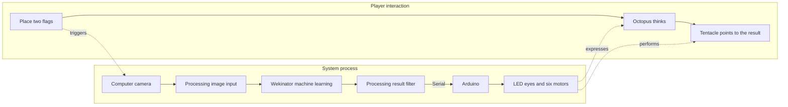
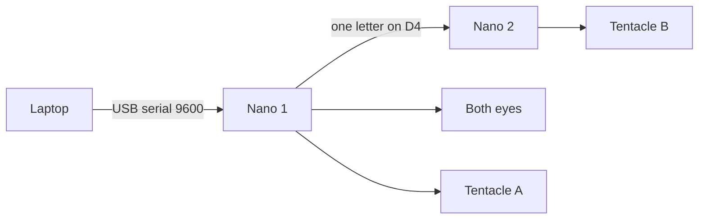
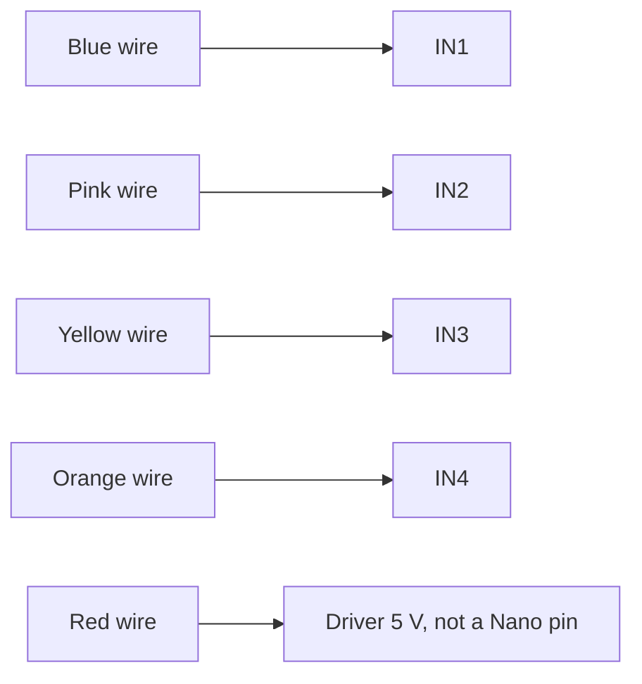
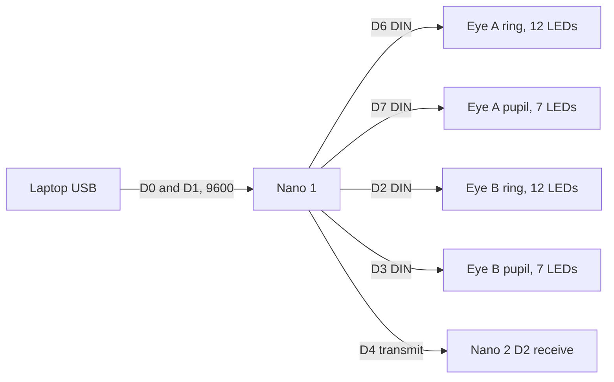
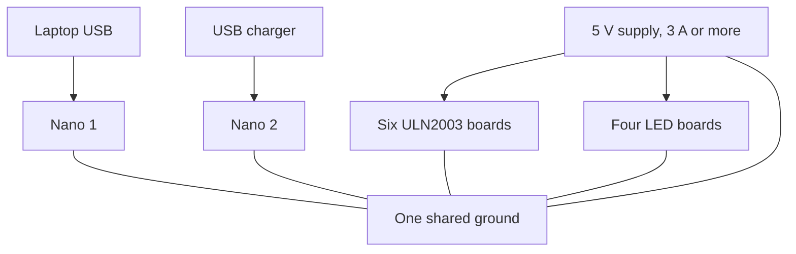
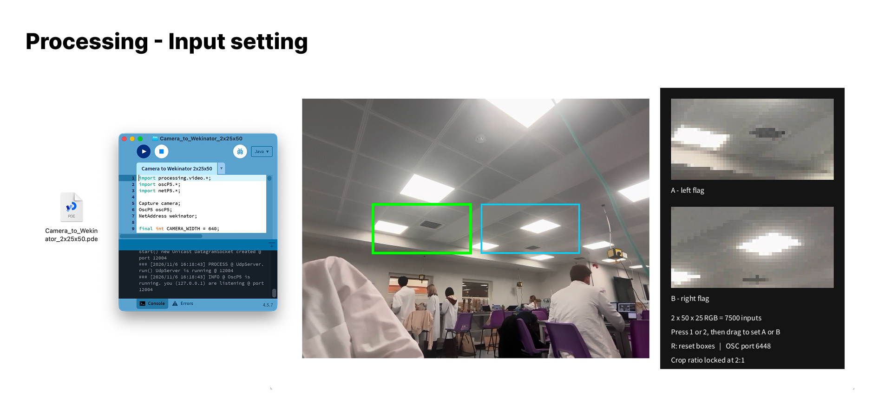
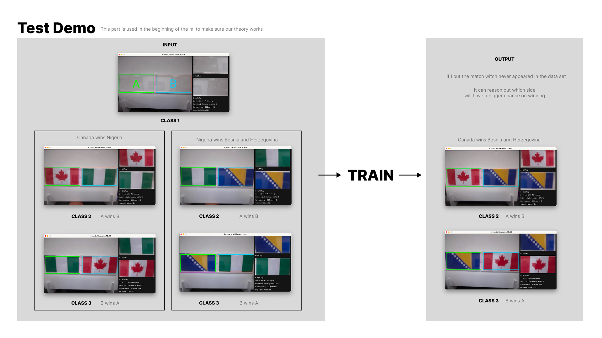
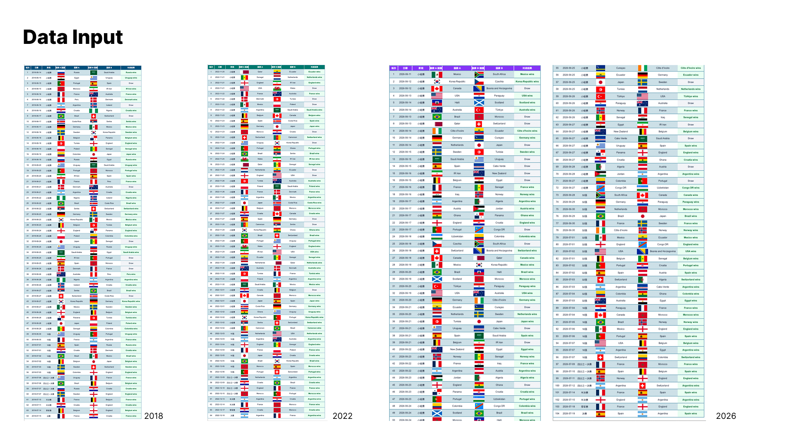

# Robot-Arm-Project

**CPS Group 21 — Paul the Octopus**

## Table of Contents

- [2. System Architecture](#system-architecture)
- [4. Hardware and Arduino](#hardware-and-arduino)
  - [4.1 Components](#hardware-components)
  - [4.2 Arduino Code](#arduino-code)
  - [4.3 Wiring](#wiring)
  - [4.4 Power](#power)
- [5. Software Design](#software-design)
  - [5.1 Software Components](#software-components)
  - [5.2 Camera Input and Image Preprocessing](#software-camera-input)
  - [5.3 Communication Interfaces](#software-communication)
  - [5.4 Round-State Filtering](#software-round-filtering)
  - [5.5 Arduino Command Handling](#software-arduino)
- [6. Machine Learning](#machine-learning)
  - [6.1 Classification Task](#ml-task)
  - [6.2 Training Data](#ml-training-data)
  - [6.3 KNN Model](#ml-model)
  - [6.4 Interpreting Class Probabilities](#ml-probabilities)
  - [6.5 Limitations and Future Improvements](#ml-limitations)

<a id="system-architecture"></a>

## 2. System Architecture

The interaction begins at the flag game board. After the player places two flag cards, the octopus shows a short thinking response through its LED eyes and tentacles, then points towards the predicted winner.



Behind the interaction, the camera captures the two flags. Processing converts both image regions into pixel data and sends them to Wekinator. The machine-learning model continuously predicts one of four match results and returns the associated class probabilities. Processing then filters the frame-by-frame predictions into one stable result for each round.

The confirmed class and the two highest probabilities are sent to Arduino through serial communication. The class determines the final pointing direction. The difference between the two probabilities represents the model's confidence and controls the thinking behaviour shown before the result.

Arduino converts the decision into LED expressions and tentacle movements. The two tentacles use six motors in total. Each tentacle has one motor for base rotation, one for the main body, and one for the tip.

### Component navigation

| Stage | Role | Detailed section |
| --- | --- | --- |
| Computer camera | Captures the left and right flag regions | [Camera Input and Image Preprocessing](#software-camera-input) |
| Processing input sketch | Crops, downsamples, and sends 7,500 RGB values | [Camera Input and Image Preprocessing](#software-camera-input) |
| Wekinator | Classifies the flag pair into one of four results | [Machine Learning](#machine-learning) |
| Processing bridge | Receives predictions, controls each round, and sends one stable command | [Round-State Filtering](#software-round-filtering) |
| OSC and serial links | Transfer data between Processing, Wekinator, and Arduino | [Communication Interfaces](#software-communication) |
| Arduino | Converts the confirmed result and confidence values into behaviour | [Arduino Command Handling](#software-arduino) |
| LEDs and motors | Express thinking and move the two tentacles | [Hardware Design](#hardware-design) |

<a id="hardware-and-arduino"></a>

## 4. Hardware and Arduino

The laptop looks at two flags and sends one line to Nano 1. Nano 1 paints both eyes, moves one tentacle, and tells Nano 2 which way to point the other tentacle.

The bench test set the motor numbers. The shaft turned with 4 milliseconds between steps and a 400 step pull. Faster steps made the motor buzz. A 12 millisecond gap only clicked. The sketches use those working numbers.

Open the `Run` folder and follow this order. Upload `Nano1_Eyes_And_TentacleA` to the Nano on the laptop, then `Nano2_TentacleB` to the second board. Board type is Arduino Nano Every, speed 9600. Then open `Run/Wekinator/Wekinator FlagMatch AB.app` from that folder, press Start listening, and press Run. Run `Camera_to_Wekinator_40x30`, then `Wekinator_to_Arduino`. Do not move the Wekinator app away from the `FlagMatch_AB_4Class` folder. Do not open Serial Monitor while the bridge sketch is running.

<a id="hardware-components"></a>

### 4.1 Components

Two Arduino Nano Every boards. One board cannot drive six steppers. Each 28BYJ-48 needs four signal wires, so the eyes and tentacle A are on the laptop board and tentacle B is on the second board.

Two eyes. Each eye is a 12-LED WS2812B ring and a 7-LED WS2812B pupil.

Six 28BYJ-48 motors, 5 V, each on its own ULN2003 board. Three motors pull one tentacle: left string, right string, and lift.

One 5 V supply of at least 3 A for the drivers and the LEDs. Two USB cables. One signal wire from Nano 1 D4 to Nano 2 D2, and a ground wire between the Nanos.

<a id="arduino-code"></a>

### 4.2 Arduino Code



The laptop sends `2,0.9900,0.0100`. That is the class, the best chance, and the next chance.

Class 1 is an empty stand, so the robot rests. Class 2 points left. Class 3 points right. Class 4 is a tie, so both tentacles shrug and the pupils look up.

If the best chance leads by 0.35 or more, the point happens at once and the rings go green. Under 0.12, the robot shrugs and rolls its pupils. In between, it leans for two seconds with amber rings, then points.

Nano 1 prints the line it understood: `RECEIVED class=2 top=0.9900 second=0.0100 pose=L`. The letter is what Nano 2 receives. `L` and `R` are a full point. `l` and `r` are the small lean. `S` is a shrug. `T` is the tie. `N` is rest. Nano 2 prints `RECEIVED letter=L`.

`POINT` and `STEP_MS` are copied in both sketches. Change them in both files or the tentacles will not match. A point winds one string 400 steps, lets the other side out 150, and lifts 200. Power on with the tentacles already in the middle. That pose is step 0.

<a id="wiring"></a>

### 4.3 Wiring

Every motor uses the same plug. This order is the one that turned the shaft. The four signal colours go to the ULN2003 inputs. Red stays on that driver and never touches a Nano pin. If a motor only buzzes, swap pink and yellow on that driver and leave the Nano pins alone.



Each ULN2003 board has four jobs. IN1, IN2, IN3, IN4 take the four Nano pins for that motor, in that order. The motor socket takes the five-wire plug. The VCC pin takes 5 V from the external supply. The GND pin joins the shared ground. Do not feed a motor from a Nano 5 V pin.

Each LED board has four pads: DIN, DOUT, 5 V, and GND. Solder the Nano data wire to DIN only. Leave DOUT empty. The four boards are not chained, because each one already has its own data pin. 5 V and GND come from the supply in the next section, the same rails as the drivers.



Nano 1 is the board on the laptop USB cable. D0 and D1 are that cable. Do not put a motor or an LED on them. The bridge sketch owns this port, so Serial Monitor has to be closed.

Eye A is the first pair. The 12-LED ring data pad goes to D6. The 7-LED pupil data pad goes to D7. Eye B is the second pair. Its ring goes to D2 and its pupil goes to D3. One data wire each. No clock wire.

The link to the other board is one wire: Nano 1 D4 to Nano 2 D2. D4 sends. D2 listens. Speed is 9600, same as the USB port, but it is a separate wire, not the USB cable. D5 on Nano 1 is the spare receive pin the library asks for. Leave it empty. The sketch pulls it high so it does not float. The two GND pins must be joined or this letter never arrives.

Tentacle A is the three motors on Nano 1. Count the pins as IN1, IN2, IN3, IN4, which is blue, pink, yellow, orange.

The left string uses D8, D9, D10, D11. D8 is IN1, D9 is IN2, D10 is IN3, D11 is IN4.

The right string uses D12, D13, A0, A1. D12 is IN1, D13 is IN2, A0 is IN3, A1 is IN4. D13 is also the onboard L LED, so that small lamp flickers while the right string moves. The power LED does not. That flicker is normal.

The lift uses A2, A3, A4, A5. A2 is IN1, A3 is IN2, A4 is IN3, A5 is IN4.

Nothing else on Nano 1 is used. A6 and A7 stay empty. The 5 V pin stays empty. VIN stays empty. GND goes to the shared ground.

Nano 2 has no eyes. Its USB socket is only power, plus a debug print if you open Serial Monitor on that board alone. D0 and D1 belong to that socket. Do not share them with Nano 1.

D2 is the listen pin. It takes the wire from Nano 1 D4. D3 is the spare transmit pin. Leave it empty. There is no wire on D3.

Tentacle B uses the same colour order.

The left string uses D4, D5, D6, D7. D4 is IN1, D5 is IN2, D6 is IN3, D7 is IN4. These are motor pins on this board. They are not the link. The link is only D2.

The right string uses D8, D9, D10, D11. D8 is IN1, D9 is IN2, D10 is IN3, D11 is IN4.

The lift uses D12, A0, A1, A2. D12 is IN1, A0 is IN2, A1 is IN3, A2 is IN4.

A3, A4, and A5 on Nano 2 stay empty. GND goes to the same shared ground as Nano 1.

<a id="power"></a>

### 4.4 Power



Do not power the motors from a Nano 5 V pin. One motor can be tried from USB. Six cannot. The coils stay on after a move so the string stays tight, and each motor can draw a few hundred milliamps while it holds.

Use the 5 V supply for every ULN2003 VCC pin and every LED 5 V pin. Nano 1 takes power from the laptop USB cable. Nano 2 takes power from a second USB cable. Tie every ground together: the supply, both Nanos, all six drivers, and all four LED boards. If a ground is missing, the D4 signal does nothing.

Unplug the motor supply before you upload. A motor loading the USB port makes the upload fail.


<a id="software-design"></a>

## 5. Software Design

The software is divided into camera capture, machine learning, result filtering, communication, and robot control. Each component can be tested separately.

```text
Camera
  ↓
Processing: crop and downsample two flag images
  ↓  OSC /wek/inputs, port 6448
Wekinator: four-class KNN model
  ↓  OSC /wek/outputs and /Match-Result, port 12000
Processing: round-state filtering and serial bridge
  ↓  USB serial, 9600 baud
Arduino: input validation and robot control
```

<a id="software-components"></a>

### 5.1 Software Components

| Component | File | Responsibility |
| --- | --- | --- |
| Camera input | `Camera_to_Wekinator_40x30/Camera_to_Wekinator_40x30.pde` | Captures regions A and B and converts them into fixed-size RGB inputs |
| Machine learning | `Wekinator FlagMatch AB.app` and `FlagMatch_AB_4Class/` | Stores the training data and KNN model and predicts the result for each flag pair |
| Arduino bridge | `processing_osc_to_arduino/processing_osc_to_arduino.pde` | Receives classes and probabilities, manages each round, and sends one confirmed result through serial |
| Robot control | `../Archive_Obsolete/RobotArm/RobotArm.ino` | Validates serial data and controls the Base, X, and Y servos |

The bridge without round-state filtering is stored in `processing_osc_to_arduino_backup/`. It can be used to test direct communication between Wekinator and Arduino.

<a id="software-camera-input"></a>

### 5.2 Camera Input and Image Preprocessing

The camera view contains two horizontal capture regions:

- Region A contains the left flag.
- Region B contains the right flag.
- Both regions use a 2:1 aspect ratio and are not stretched.
- Each region is downsampled to 50 × 25 pixels.
- Each pixel contributes red, green, and blue values.

Each flag produces:

```text
50 × 25 × 3 = 3,750 inputs
```

The two regions are combined into one OSC message:

```text
3,750 + 3,750 = 7,500 inputs
```

Values 1–3,750 belong to region A, and values 3,751–7,500 belong to region B. Wekinator distinguishes the images by their fixed positions in the input array.

<a id="software-communication"></a>

### 5.3 Communication Interfaces



*Figure 5.1. The Processing sketch captures two flag regions and sends 7,500 RGB values to Wekinator through OSC port 6448.*

The camera sketch sends image data to Wekinator:

```text
Address: /wek/inputs
Port: 6448
Values: 7,500 floats
```


*Figure 5.2. The Wekinator project listens for camera input on port 6448 and runs the four-class model.*

Wekinator returns the predicted class and class probabilities:

```text
/wek/outputs    Predicted class
/Match-Result   Class probabilities
Port: 12000
```

The Processing bridge sends one CSV line to Arduino:

```text
<class>,<top_probability>,<second_probability>
```

For example:

```text
2,0.7426,0.1831
```

This represents Class 2, with a top probability of 0.7426 and a second-place probability of 0.1831. Processing and Arduino both use a baud rate of 9600.

<a id="software-round-filtering"></a>

### 5.4 Round-State Filtering

Wekinator evaluates every camera frame. Small changes in lighting, position, or camera noise can make the predicted class switch between frames. Sending every prediction directly to Arduino could therefore trigger repeated or conflicting movements.

The Processing bridge uses the following round-state sequence:

```text
Class 1 remains stable for 500 ms
  ↓
The next round is armed
  ↓
Class 2–4 is first detected
  ↓
Wait 2 seconds for the player to place both flags
  ↓
Record predictions for 2 seconds
  ↓
Select the most frequently detected class
  ↓
Send one confirmed result
  ↓
Lock until Class 1 is detected again
```

During the two-second observation period, Processing counts the occurrences of Classes 2–4. The most frequently detected class becomes the final result. The bridge also averages the two highest probabilities from samples associated with that class.

After sending the result, the bridge ignores further predictions until Class 1 remains stable again. Removing both flags therefore ends the current round and enables the next one.

<a id="software-arduino"></a>

### 5.5 Arduino Command Handling

Arduino validates each serial message before starting a movement. The confirmed class selects the final pointing action, while the difference between the two probability values controls the confidence-dependent thinking behaviour.

The current Arduino program also waits three seconds before moving. When this delay is used together with the two-second placement period and two-second observation period in Processing, the robot responds approximately seven seconds after the first non-empty prediction.

<a id="machine-learning"></a>

## 6. Machine Learning

<a id="ml-task"></a>

### 6.1 Classification Task

The project uses a four-class classifier:

| Class | Label |
| --- | --- |
| 1 | Nothing / empty board |
| 2 | A beats B |
| 3 | B beats A |
| 4 | Draw |

The model maps a pair of flag images directly to a match result. It does not identify each country separately or query an external football database.

For matches with a winner, both left-right arrangements are recorded. If the winning flag is in region A, the sample is labelled Class 2. After swapping the flags, it is labelled Class 3. A draw remains Class 4 in both arrangements.


*Figure 6.1. The same flag contributes to Class 2 or Class 3 depending on whether it appears on the left or right, allowing the model to infer previously unseen pairings.*

<a id="ml-training-data"></a>

### 6.2 Training Data

Before collecting the full dataset, we trained a small demo model using a limited set of known matchups. We then tested it with a flag pairing that had not appeared in the demo training set. The model followed the expected left-right winner structure, confirming that the proposed image-classification approach was viable before full-scale data collection.



*Figure 6.2. The initial demo verified the camera input, class structure, and ability to generalise the winner direction to an unseen flag pairing.*

When `Start Recording` is active, every captured frame becomes an independent training example. Each recording session contains about 30 frames, with a possible difference of one or two frames because recording is stopped manually.

Using a similar number of frames for each matchup prevents one recorded matchup from contributing much more data than another. To reduce near-duplicate static frames, each block of approximately 30 examples was later reduced to five representative examples. The classes remain imbalanced because the source match records contain different numbers of wins and draws.



*Figure 6.3. Match records were converted into left-win, right-win, and draw labels for the flag-pair training data.*

The reduced dataset contains 2,370 examples:

| Class | Examples |
| --- | ---: |
| Class 1 | 30 |
| Class 2 | 971 |
| Class 3 | 992 |
| Class 4 | 377 |
| **Total** | **2,370** |

Recording a static scene still produces very similar examples. More useful variation comes from changes in:

- flag position;
- camera distance;
- lighting and screen illumination;
- background and shadows.

Both flags should remain fully inside their capture regions.

<a id="ml-model"></a>

### 6.3 KNN Model

Wekinator uses a K-Nearest Neighbours classifier:

```text
K = 17
```

The model finds the 17 closest training examples and predicts one of Classes 1–4 from their labels.

A single recording originally produced about 30 highly similar frames. After retaining five representative examples from each block, `K = 17` allows the neighbourhood to extend beyond one retained recording block while remaining sensitive to visually similar flag pairs.

The value of K can reduce the influence of one small cluster, but it cannot correct class imbalance or missing lighting and position variations. Frame-level instability is therefore handled separately by the Processing round-state filter.

<a id="ml-probabilities"></a>

### 6.4 Interpreting Class Probabilities

Wekinator's class probabilities are based on the labels of nearby KNN examples. They are not calibrated probabilities and should not be interpreted as the real-world chance of a team winning.

For an identical input, KNN should return the same result. If the probability changes while the scene appears still, the pixel values are usually changing because of camera noise, automatic exposure, shadows, or small movements. The model does not accumulate confidence over time.

The total number of examples in a class also does not guarantee that the class will win a prediction. KNN mainly depends on the examples closest to the current input.

Frame-level predictions are stabilised by Processing rather than by the model itself. See [Round-State Filtering](#software-round-filtering) for the complete timing and decision logic.

<a id="ml-limitations"></a>

### 6.5 Limitations and Future Improvements

The model uses low-resolution RGB pixels, so lighting, reflections, shadows, background changes, and flag position can affect its output. It learns pixel similarity rather than flag identity, country information, or football rules.

The dataset is imbalanced, and evaluation currently relies on live observation. There is no separate test set or confusion matrix. The displayed probabilities are useful for interaction and motion control, but they are not calibrated confidence scores or real match predictions.

Possible improvements include:

- balancing the four classes;
- reducing duplicate frames;
- recording more lighting, distance, and position variations;
- reserving some flag pairs for testing;
- measuring errors with a confusion matrix;
- adding colour normalisation or more stable visual features.
