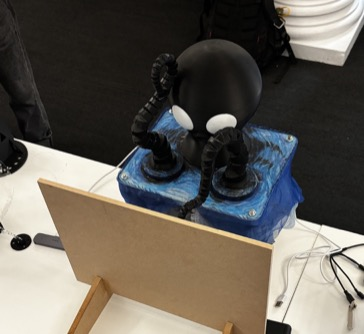
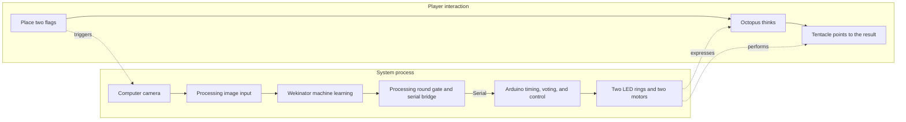
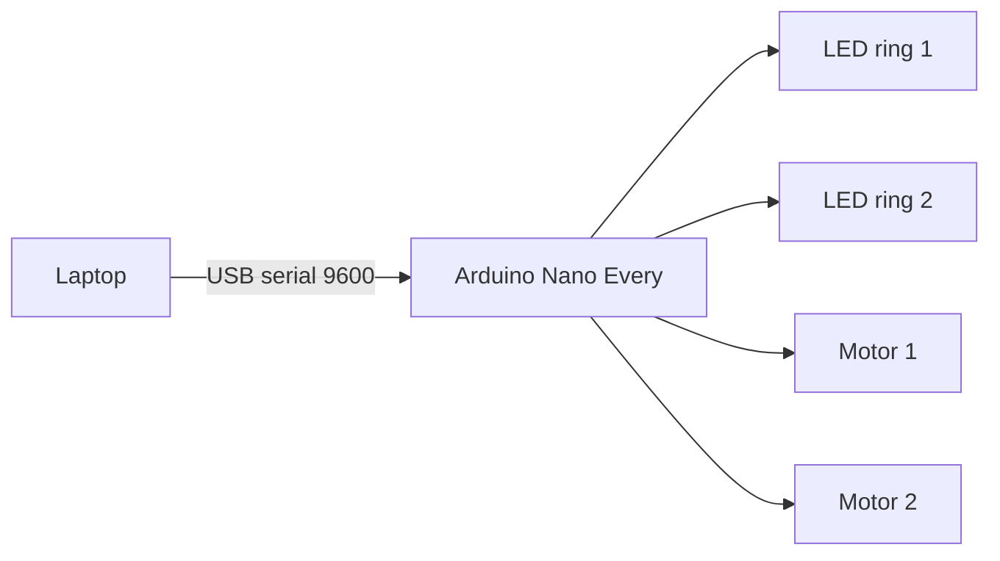
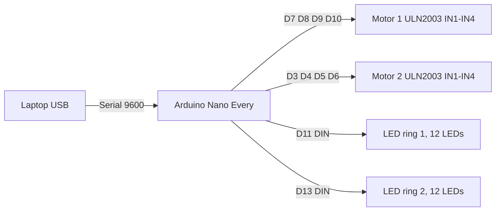
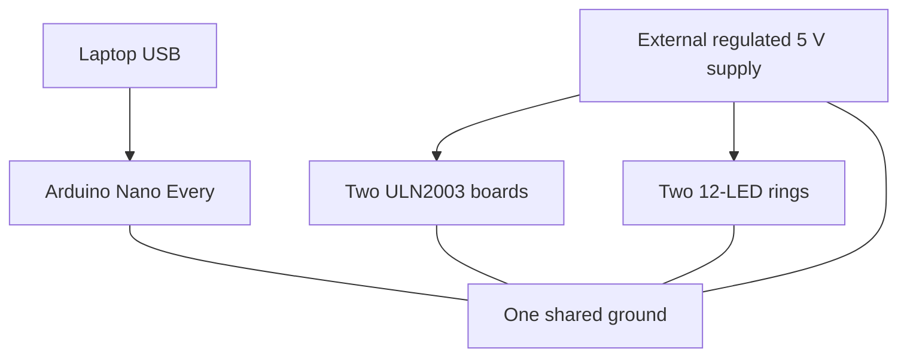

# Paul the Octopus

**CPS Group 21**



## Table of Contents

- [2. System Architecture](#system-architecture)
- [4. Hardware and Arduino](#hardware-and-arduino)
  - [4.1 Components](#hardware-components)
  - [4.2 Arduino Code](#arduino-code)
  - [4.3 Wiring](#wiring)
  - [4.4 Power](#power)
- [5. Software Design](#software-design)
  - [5.1 Software Components](#software-components)
  - [5.2 Camera Input and Image Preprocessing](#software-camera-input)
  - [5.3 Communication Interfaces](#software-communication)
  - [5.4 Round-State Filtering](#software-round-filtering)
  - [5.5 Arduino Command Handling](#software-arduino)
- [6. Machine Learning](#machine-learning)
  - [6.1 Classification Task](#ml-task)
  - [6.2 Training Data](#ml-training-data)
  - [6.3 KNN Model](#ml-model)
  - [6.4 Interpreting Class Probabilities](#ml-probabilities)
  - [6.5 Limitations and Future Improvements](#ml-limitations)

<a id="system-architecture"></a>

## 2. System Architecture

The interaction begins at the flag game board. After the player places two flag cards, the octopus shows a short thinking response through its LED eyes and tentacles, then points towards the predicted winner.



Behind the interaction, the camera captures the two flags. Processing converts both image regions into pixel data and sends them to Wekinator. The machine-learning model continuously predicts one of four match results and returns the associated class probabilities. The Processing bridge uses a stable Class 1 to arm each round, then forwards the live predictions to Arduino every 100 ms.

Arduino owns the decision timing. After the first Class 2–4 prediction, it allows four seconds for flag placement and then records predictions for two seconds. The most frequently received class determines the final action. The current firmware uses the highest probability—not the difference between the two highest probabilities—to select the thinking behaviour. The second probability is still transmitted and recorded for reference.

One Arduino Nano Every converts the decision into LED expressions and motor movements. It controls two 12-LED rings and two stepper motors directly.

### Component navigation

| Stage | Role | Detailed section |
| --- | --- | --- |
| Computer camera | Captures the left and right flag regions | [Camera Input and Image Preprocessing](#software-camera-input) |
| Processing input sketch | Crops, downsamples, and sends 7,500 RGB values | [Camera Input and Image Preprocessing](#software-camera-input) |
| Wekinator | Classifies the flag pair into one of four results | [Machine Learning](#machine-learning) |
| Processing bridge | Arms each round from Class 1 and forwards live predictions to Arduino | [Round-State Filtering](#software-round-filtering) |
| OSC and serial links | Transfer data between Processing, Wekinator, and Arduino | [Communication Interfaces](#software-communication) |
| Arduino | Times flag placement, votes on the result, and converts confidence into behaviour | [Arduino Command Handling](#software-arduino) |
| LEDs and motors | Express thinking and perform the two-motor result action | [Hardware and Arduino](#hardware-and-arduino) |

<a id="hardware-and-arduino"></a>

## 4. Hardware and Arduino

The laptop sends one CSV line at a time to a single Arduino Nano Every through USB serial. The Nano controls both LED rings and both stepper motors; there is no second Arduino or board-to-board serial link in the current system.

The current sketch uses a 4 ms step interval for Motor 1 and a 3 ms interval for Motor 2. Class 2 moves Motor 1 by 350 steps in one direction, while Class 3 moves it by 230 steps in the opposite direction. Motor 2 performs two cycles of 1,400 steps up and 600 steps down for an accepted result.

Upload `Arduino Code/Nano2_TentacleB_motor_test/Nano2_TentacleB_motor_test.ino` to the Nano Every. Despite the legacy filename, this is the current single-board sketch. Open `Wekinator Project/FlagMatch_AB_4Class/FlagMatch_AB_4Class.wekproj` with the installed Wekinator application, start listening on port 6448, and run the model. Then run `Processing Code/Camera_to_Wekinator_2x25x50/Camera_to_Wekinator_2x25x50.pde`, followed by `Processing Code/processing_osc_to_arduino/processing_osc_to_arduino.pde`. Close Arduino Serial Monitor before starting the Processing bridge because both programs cannot use the same USB serial port simultaneously.

<a id="hardware-components"></a>

### 4.1 Components

The current hardware uses:

- one Arduino Nano Every connected to the laptop by USB;
- two 28BYJ-48 5 V stepper motors, each with its own ULN2003 driver board;
- two 12-LED WS2812B rings;
- one external regulated 5 V supply for the motors and LED rings; and
- one shared ground between the external supply and the Nano.

<a id="arduino-code"></a>

### 4.2 Arduino Code



The laptop sends `2,0.9900,0.0100`. That is the class, the best chance, and the next chance.

Class 1 arms or resets the round. Class 2 moves Motor 1 in one direction, Class 3 moves it in the opposite direction, and Class 4 leaves Motor 1 centred. For an accepted result with a top probability of at least 0.4, Motor 2 then performs two up-and-down cycles. A result below 0.4 stops after the unknown gesture without running the final motor action.

The current firmware uses the highest probability directly. Above 0.8, it performs the result action immediately. From 0.6 to 0.8, the eyes complete three laps before the result. From 0.4 to 0.6, the eyes complete five laps while Motor 1 sways slowly. Below 0.4, the robot performs the unknown gesture and does not continue to the result action. For the first three ranges, the rings turn green before the motor action.

The Nano reports its state through the same USB serial connection. Important messages include `WAITING_FOR_ARM`, `ARMED`, `PLACEMENT 4s`, `OBSERVING 2s`, `LOCKED`, `DECISION`, `DONE`, and `CANCELLED false trigger`. Processing uses `LOCKED` and `DONE` to coordinate the round gate.

<a id="wiring"></a>

### 4.3 Wiring



Motor 1 uses Nano pins D7, D8, D9, and D10 in ULN2003 IN1-to-IN4 order. Motor 2 uses D3, D4, D5, and D6. Each motor remains connected to its own ULN2003 motor socket; the driver VCC and GND connect to the external 5 V supply.

LED ring 1 receives data on D11 and LED ring 2 receives data on D13. Each ring has 12 WS2812B LEDs. Connect each data wire to `DIN`, not `DOUT`. D13 is also connected to the Nano's onboard LED, so the onboard lamp may flicker when the second ring updates.

The Nano communicates with Processing through its USB serial connection at 9600 baud. Keep Serial Monitor closed while the Processing bridge is running. Connect the Nano ground, both ULN2003 grounds, both LED grounds, and the external-supply ground together.

<a id="power"></a>

### 4.4 Power



Do not power either motor from the Nano 5 V pin. Use the external 5 V supply for both ULN2003 VCC pins and both LED rings.

The Nano takes power from the laptop USB cable. Tie together the grounds of the supply, Nano, both motor drivers, and both LED rings. Without the shared ground, the motor and LED control signals may not work reliably.

Unplug the motor supply before you upload. A motor loading the USB port makes the upload fail.


<a id="software-design"></a>

## 5. Software Design

The software is divided into camera capture, machine learning, Processing round gating, Arduino result voting, communication, and robot control. Each component can be tested separately.

```text
Camera
  ↓
Processing: crop and downsample two flag images
  ↓  OSC /wek/inputs, port 6448
Wekinator: four-class KNN model
  ↓  OSC /wek/outputs and /Match-Result, port 12000
Processing: Class 1 round gate and serial bridge
  ↓  USB serial, 9600 baud
Arduino: 4 s placement, 2 s voting, confidence and robot control
```

<a id="software-components"></a>

### 5.1 Software Components

| Component | File | Responsibility |
| --- | --- | --- |
| Camera input | `Camera_to_Wekinator_40x30/Camera_to_Wekinator_40x30.pde` | Captures regions A and B and converts them into fixed-size RGB inputs |
| Machine learning | `Wekinator FlagMatch AB.app` and `FlagMatch_AB_4Class/` | Stores the training data and KNN model and predicts the result for each flag pair |
| Arduino bridge | `processing_osc_to_arduino/processing_osc_to_arduino.pde` | Arms each round from Class 1 and forwards live classes and probabilities through serial |
| Robot control | `Arduino Code/Nano2_TentacleB_motor_test/Nano2_TentacleB_motor_test.ino` | Validates serial data and controls two stepper motors and two LED rings |

The bridge without round-state filtering is stored in `processing_osc_to_arduino_backup/`. It can be used to test direct communication between Wekinator and Arduino.

<a id="software-camera-input"></a>

### 5.2 Camera Input and Image Preprocessing


*Figure 5.1. The Processing sketch captures two flag regions and sends 7,500 RGB values to Wekinator through OSC port 6448.*

The camera view contains two horizontal capture regions:

- Region A contains the left flag.
- Region B contains the right flag.
- Both regions use a 2:1 aspect ratio and are not stretched.
- Each region is downsampled to 50 × 25 pixels.
- Each pixel contributes red, green, and blue values.

Each flag produces:

```text
50 × 25 × 3 = 3,750 inputs
```

The two regions are combined into one OSC message:

```text
3,750 + 3,750 = 7,500 inputs
```

Values 1–3,750 belong to region A, and values 3,751–7,500 belong to region B. Wekinator distinguishes the images by their fixed positions in the input array.

<a id="software-communication"></a>

### 5.3 Communication Interfaces

The camera sketch sends image data to Wekinator:

```text
Address: /wek/inputs
Port: 6448
Values: 7,500 floats
```


*Figure 5.2. The Wekinator project listens for camera input on port 6448 and runs the four-class model.*

Wekinator returns the predicted class and class probabilities:

```text
/wek/outputs    Predicted class
/Match-Result   Class probabilities
Port: 12000
```

The Processing bridge sends one CSV line to Arduino:

```text
<class>,<top_probability>,<second_probability>
```

For example:

```text
2,0.7426,0.1831
```

This represents Class 2, with a top probability of 0.7426 and a second-place probability of 0.1831. Processing and Arduino both use a baud rate of 9600.

<a id="software-round-filtering"></a>

### 5.4 Round-State Filtering

Wekinator evaluates every camera frame. Small changes in lighting, position, or camera noise can make the predicted class switch between frames. Sending every prediction directly to Arduino could therefore trigger repeated or conflicting movements.

Processing and Arduino divide the round-state sequence as follows:

```text
Processing: Class 1 remains stable for 500 ms
  ↓
Processing sends 1,1.0000,0.0000 and arms the round
  ↓
Class 2–4 is first detected
  ↓
Processing forwards live predictions every 100 ms
  ↓
Arduino waits 4 seconds for flag placement
  ↓
Arduino records Classes 2–4 for 2 seconds
  ↓
Arduino selects the most frequently received class
  ↓
Arduino performs the thinking and result action
  ↓
Arduino sends DONE
  ↓
Processing waits for 3 seconds of stable Class 1 before re-arming
```

During the two-second observation period, Arduino counts the occurrences of Classes 2–4. The class with the most votes becomes the final result; if two classes have equal votes, the latest observed class wins the tie. Arduino also averages the transmitted top and second probabilities from samples associated with the winning class.

Processing continues forwarding predictions while the round is active so Arduino can observe the changing result and detect a false trigger. If Class 1 persists for three seconds during placement, observation, or an unfinished action, Arduino cancels the round. After Arduino sends `DONE`, Processing waits for three seconds of stable Class 1, sends the reset command, and enables the next round.

<a id="software-arduino"></a>

### 5.5 Arduino Command Handling

Arduino validates every CSV message before using it. During the observation window, it votes on Classes 2–4 and averages the two transmitted probability values for the winning class. The winning class selects the final action.

The thinking behaviour is selected from the averaged top probability: above 0.8 is a direct result; 0.6–0.8 produces three eye laps; 0.4–0.6 produces five eye laps with a slow Motor 1 sway; and below 0.4 produces the unknown gesture without a final result action. The second probability is retained for logging but is not currently used to select the confidence range.

From the first Class 2–4 prediction, the fixed decision period is approximately six seconds: four seconds for placement followed by two seconds of observation. Thinking and motor movements add variable time after that decision. The separate three-second Class 1 period is used to cancel a false trigger or re-arm the next round; it is not an extra delay before every result.

<a id="machine-learning"></a>

## 6. Machine Learning

<a id="ml-task"></a>

### 6.1 Classification Task

The project uses a four-class classifier:

| Class | Label |
| --- | --- |
| 1 | Nothing / empty board |
| 2 | A beats B |
| 3 | B beats A |
| 4 | Draw |

The model maps a pair of flag images directly to a match result. It does not identify each country separately or query an external football database.

For matches with a winner, both left-right arrangements are recorded. If the winning flag is in region A, the sample is labelled Class 2. After swapping the flags, it is labelled Class 3. A draw remains Class 4 in both arrangements.


*Figure 6.1. The same flag contributes to Class 2 or Class 3 depending on whether it appears on the left or right, allowing the model to infer previously unseen pairings.*

<a id="ml-training-data"></a>

### 6.2 Training Data

Before collecting the full dataset, we trained a small demo model using a limited set of known matchups. We then tested it with a flag pairing that had not appeared in the demo training set. The model followed the expected left-right winner structure, confirming that the proposed image-classification approach was viable before full-scale data collection.


*Figure 6.2. The initial demo verified the camera input, class structure, and ability to generalise the winner direction to an unseen flag pairing.*

When `Start Recording` is active, every captured frame becomes an independent training example. Each recording session contains about 30 frames, with a possible difference of one or two frames because recording is stopped manually.

Using a similar number of frames for each matchup prevents one recorded matchup from contributing much more data than another. To reduce near-duplicate static frames, each block of approximately 30 examples was later reduced to five representative examples. The classes remain imbalanced because the source match records contain different numbers of wins and draws.


*Figure 6.3. Match records were converted into left-win, right-win, and draw labels for the flag-pair training data.*

The reduced dataset contains 2,370 examples:

| Class | Examples |
| --- | ---: |
| Class 1 | 30 |
| Class 2 | 971 |
| Class 3 | 992 |
| Class 4 | 377 |
| **Total** | **2,370** |

Recording a static scene still produces very similar examples. More useful variation comes from changes in:

- flag position;
- camera distance;
- lighting and screen illumination;
- background and shadows.

Both flags should remain fully inside their capture regions.

<a id="ml-model"></a>

### 6.3 KNN Model

Wekinator uses a K-Nearest Neighbours classifier:

```text
K = 17
```

The model finds the 17 closest training examples and predicts one of Classes 1–4 from their labels.

A single recording originally produced about 30 highly similar frames. After retaining five representative examples from each block, `K = 17` allows the neighbourhood to extend beyond one retained recording block while remaining sensitive to visually similar flag pairs.

The value of K can reduce the influence of one small cluster, but it cannot correct class imbalance or missing lighting and position variations. Frame-level instability is therefore handled separately by the Processing round-state filter.

<a id="ml-probabilities"></a>

### 6.4 Interpreting Class Probabilities

Wekinator's class probabilities are based on the labels of nearby KNN examples. They are not calibrated probabilities and should not be interpreted as the real-world chance of a team winning.

For an identical input, KNN should return the same result. If the probability changes while the scene appears still, the pixel values are usually changing because of camera noise, automatic exposure, shadows, or small movements. The model does not accumulate confidence over time.

The total number of examples in a class also does not guarantee that the class will win a prediction. KNN mainly depends on the examples closest to the current input.

Frame-level predictions are stabilised by Processing rather than by the model itself. See [Round-State Filtering](#software-round-filtering) for the complete timing and decision logic.

<a id="ml-limitations"></a>

### 6.5 Limitations and Future Improvements

The model uses low-resolution RGB pixels, so lighting, reflections, shadows, background changes, and flag position can affect its output. It learns pixel similarity rather than flag identity, country information, or football rules.

The dataset is imbalanced, and evaluation currently relies on live observation. There is no separate test set or confusion matrix. The displayed probabilities are useful for interaction and motion control, but they are not calibrated confidence scores or real match predictions.

Possible improvements include:

- balancing the four classes;
- reducing duplicate frames;
- recording more lighting, distance, and position variations;
- reserving some flag pairs for testing;
- measuring errors with a confusion matrix;
- adding colour normalisation or more stable visual features.
