# Paul the Octopus

**CPS Group 21**

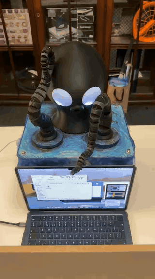


## Table of Contents
- [1. Project Overview](#project-overview)
  - [1.1 Inspiration](#inspiration)
  - [1.2 Project Concept](#inspiration)
  - [1.3 System Operation](#system_operation)
    - [1.3.1 Input and Prediction](#input_and_prediction)
    - [1.3.2 Decision Making](#decision_making)
    - [1.3.3 Mechanical Response](#mechanical_response)
  - [1.4 Project Aim](#project_aim)
- [2. System Architecture](#system-architecture)
- [3. Mechanism](#mechanism)
  - [3.1 Mechanical Overview](#mechanical-overview)
  - [3.2 Component List](#component-list)
  - [3.3 Base and Rotational Assembly](#base-and-rotational-assembly)
  - [3.4 Motor and Gear Assembly](#motor-and-gear-assembly)
  - [3.5 Robot Arm Structure](#robot-arm-structure)
  - [3.6 Tentacle Design and Construction](#tentacle-design-and-construction)
  - [3.7 Cable Actuation and Tensioning](#Cable-Actuation-and-Tensioning)
  - [3.8 Modifications and Final Assembly](#Modifications-and-Final-Assembly)
- [4. Hardware and Arduino](#hardware-and-arduino)
  - [4.1 Components needed](#hardware-components)
  - [4.2 Arduino Code](#arduino-code)
  - [4.3 Wiring](#wiring)
  - [4.4 Power](#power)
- [5. Software Design](#software-design)
  - [5.1 Software Components](#software-components)
  - [5.2 Camera Input and Image Preprocessing](#software-camera-input)
  - [5.3 Communication Interfaces](#software-communication)
  - [5.4 Round-State Filtering](#software-round-filtering)
  - [5.5 Arduino Command Handling](#software-arduino)
- [6. Machine Learning](#machine-learning)
  - [6.1 Classification Task](#ml-task)
  - [6.2 Training Data](#ml-training-data)
  - [6.3 KNN Model](#ml-model)
  - [6.4 Interpreting Class Probabilities](#ml-probabilities)
  - [6.5 Limitations and Future Improvements](#ml-limitations)
- [7. Machine Learning](#machine-learning)
  - [7.1 Classification Task](#ml-task)
  - [7.2 Training Data](#ml-training-data)
  - [7.3 KNN Model](#ml-model)
  - [7.4 Interpreting Class Probabilities](#ml-probabilities)
- [8. Final Outcome & Demonstration](#final)
- [9. Limitations and Future Improvements](#ml-limitations)

<a id="project-overview"></a>

## 1. Project Overview

<a id="inspiration"></a>

### 1.1 Inspiration

Our project has been heavily influenced by the infamous Paul the Octopus. Paul was a common octopus who became internationally renowned during the 2010 FIFA World Cup in South Africa for his rather impressive ability to predict the outcomes of football matches.

His predictions were made by presenting him with two boxes of food, each marked with the flag of one of the competing nations. Paul would then move towards one of the boxes, with his choice representing his prediction for the winning team. By the end of the tournament, Paul had successfully predicted all eight matches he was asked to forecast, earning himself worldwide recognition (and probably a fair amount of resentment from the losing nations).

Our project for CPS is an attempt to revive Paul in all his former glory, bringing his questionable yet seemingly remarkable predictive abilities into the world of robotics and machine learning.

<a id="project_concept"></a>

### 1.2 Project Concept

The idea is to recreate Paul's prediction system using a combination of computer vision, machine learning, electronics and mechanical engineering. Instead of choosing between two boxes of food, our robotic octopus is presented with two national flags, which it then uses to predict the outcome of a football match.

The flags are captured using a camera and processed through Wekinator, where a machine-learning model attempts to classify the pairing into one of four possible outcomes:

- Class 1 – Empty board / no flags detected
- Class 2 – Flag A beats Flag B
- Class 3 – Flag B beats Flag A
- Class 4 – Draw

<a id="system_operation"></a>

### 1.3 System Operation

The system is broken down into three main stages:

<a id="input_and_prediction"></a>

#### 1.3.1 Input and Prediction

Once the two flags have been presented, a camera captures the images and sends them into Processing. The images are cropped, resized and converted into RGB pixel data before being transferred to Wekinator. Here, a K-Nearest Neighbours (KNN) model compares the input against its trained dataset and produces a prediction based on the two flags presented.

<a id="decision_making"></a>

#### 1.3.2 Decision Making

The predicted result and its associated probabilities are then passed back through Processing and communicated to an Arduino Nano Every. The Arduino monitors the incoming predictions over a timed period, allowing it to filter out changes between individual predictions before settling on a final result.

<a id="mechanical_response"></a>

#### 1.3.3 Mechanical Response

Once a result has been established, the Arduino controls the LED eyes and stepper motors, which in turn operate the two mechanical tentacles. These movements, alongside the LED expressions, are used to communicate the outcome and give Paul a little bit of personality. Depending on the prediction and its associated probability, the robot will produce different movements, ranging from a confident indication of a winner to a more uncertain response.

<a id="project_aim"></a>

### 1.4 Project Aim

Ultimately, the aim is to create an interactive robotic character that combines machine learning with physical movement, recreating the experience of asking Paul the Octopus to predict the outcome of a football match.

<a id="system-architecture"></a>

## 2. System Architecture

The interaction begins at the flag game board. After the player places two flag cards, the octopus shows a short thinking response through its LED eyes and tentacles, then points towards the predicted winner.

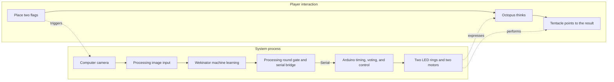

Behind the interaction, the camera captures the two flags. Processing converts both image regions into pixel data and sends them to Wekinator. The machine-learning model continuously predicts one of four match results and returns the associated class probabilities. The Processing bridge uses a stable Class 1 to arm each round, then forwards the live predictions to Arduino every 100 ms.

Arduino owns the decision timing. After the first Class 2–4 prediction, it allows four seconds for flag placement and then records predictions for two seconds. The most frequently received class determines the final action. The current firmware uses the highest probability—not the difference between the two highest probabilities—to select the thinking behaviour. The second probability is still transmitted and recorded for reference.

One Arduino Nano Every converts the decision into LED expressions and motor movements. It controls two 12-LED rings and two stepper motors directly.

### Component navigation

| Stage | Role | Detailed section |
| --- | --- | --- |
| Computer camera | Captures the left and right flag regions | [Camera Input and Image Preprocessing](#software-camera-input) |
| Processing input sketch | Crops, downsamples, and sends 7,500 RGB values | [Camera Input and Image Preprocessing](#software-camera-input) |
| Wekinator | Classifies the flag pair into one of four results | [Machine Learning](#machine-learning) |
| Processing bridge | Arms each round from Class 1 and forwards live predictions to Arduino | [Round-State Filtering](#software-round-filtering) |
| OSC and serial links | Transfer data between Processing, Wekinator, and Arduino | [Communication Interfaces](#software-communication) |
| Arduino | Times flag placement, votes on the result, and converts confidence into behaviour | [Arduino Command Handling](#software-arduino) |
| LEDs and motors | Express thinking and perform the two-motor result action | [Hardware and Arduino](#hardware-and-arduino) |

<a id="mechanism"></a>

## 3. Mechanism

<a id="mechanical-overview"></a>

### 3.1 Mechanical Overview

The mechanical system consists of six stepper motors in total, with three motors controlling each arm. Both arms use an identical mechanism, mirrored to create a duplicated system on either side of the robot.

Each arm has three separate movements, controlled by its own motor:

- Motor A – Directional rotation: Controls the horizontal direction in which the tentacle points.
- Motor B – Main tentacle articulation: Controls the bending movement of the first two thirds of the tentacle.
- Motor C – Tip articulation: Controls the bending movement of the final third of the tentacle independently of the lower section.

By combining these three movements, each tentacle can rotate to face a particular direction, bend into different positions and produce more expressive gestures.
The mechanism is designed around a rotating central assembly, with the three motors and their associated drive systems mounted onto a circular rotating base. This allows the entire assembly to rotate together while maintaining the positioning of the individual motor and pulley systems.

<a id="component-list"></a>

### 3.2 Component List

Each arm consists of the following main components:

| Component | Quantity |
|---|:---:|
| Base plate | 1 |
| Flanged block bearing mount | 1 |
| Stepper motors | 3 |
| Motor mounts | 3 |
| Motor-to-cog coupler | 1 |
| Drive cogs | 2 |
| Circular rotating base plate | 1 |
| Central vertical axle | 1 |
| Hollow vertical tube | 1 |
| Rod coupler | 1 |
| Grub screws | 2 |
| Manual micro-tensioning systems | 2 |
| Pulley spools | 4 |
| Pulley bearing mounts | 2 |
| Pulley shafts | 2 |
| Cable systems | 2 |
| Segmented 3D-printed tentacle | 1 |
| Bearings | 5 |
| Upper circular tentacle mount | 1 |
| Upper structural plate | 1 |
| Pillow block bearing mounts | 2 |

<a id="base-and-rotational-assembly"></a>

### 3.3 Base and Rotational Assembly

The mechanism begins with the base plate, onto which a flanged block bearing mount is fixed. This provides the main support and bearing point for the vertical rotational assembly.

Motor A is mounted onto the base plate with its axle positioned vertically. The motor drives a cog system which transfers its rotational movement to a larger vertical axle. This axle supports the circular rotating base plate, onto which the remaining two motors and their associated pulley systems are mounted.

As Motor A turns, the cog system rotates the central axle and, consequently, the entire upper assembly. This includes Motors B and C, their pulley systems and the tentacle mounted above. By rotating the complete assembly together, the tentacle can change its pointing direction without interfering with the cable mechanisms controlling its articulation.

The rotation is limited to approximately 180 degrees, allowing the tentacle to point in different directions while remaining within the intended movement range.

#### Drive connection

The driven cog is mounted onto the central shaft using a push-fit friction connection. The circular rotating base plate is then connected to the cog using an offset locating pin, mechanically linking the two components so that they rotate together.


<a id="motor-and-gear-assembly"></a>

### 3.4 Motor and Gear Assembly

Motor A provides the directional movement of the tentacle, while Motors B and C are responsible for its bending.
Both articulation motors are mounted horizontally onto the circular rotating base plate. They operate through separate pulley systems which pull the cables running through the tentacle.

The pulley assemblies use the same basic arrangement, consisting of a motor and motor mount, two spool holders, a manual micro-tensioning mechanism and an end bearing mount with a supporting shaft.

#### The general arrangement is:

Motor and motor mount → Spool → Female tensioning component → Male tensioning component → Spool → Bearing mount

The bearing mount supports the far end of the pulley assembly, keeping the shaft aligned and providing support as the spools rotate.
As the two articulation motors are mounted onto the same rotating base, their entire pulley assemblies rotate with the tentacle when Motor A changes its direction.


<a id="robot-arm-structure"></a>

### 3.5 Robot Arm Structure

The two articulation motors operate on different sections of the tentacle. Although they use the same general pulley arrangement, their cables follow different routes through the structure.

#### Motor B – Main tentacle articulation

Motor B controls the first two thirds of the tentacle.

Its cable is wound around the first spool, with several turns to help prevent slipping. From there, it travels through the hollow central vertical tube and into the base of the tentacle.

The cable is routed through the outer holes in the segmented structure, travelling up to approximately two thirds of the tentacle's length. At this point, it passes across to the opposite side and returns down through the structure and central tube, eventually connecting to the second spool.

This arrangement allows Motor B to pull the cable and bend the main section of the tentacle.

#### Motor C – Independent tip articulation

Motor C controls the final third of the tentacle, allowing the tip to bend independently of the main section.

Its cable follows a similar route through the central vertical tube and into the tentacle. However, rather than travelling through the outer holes from the base, it initially follows the central route up the tentacle.

At approximately one third from the tip, the cable moves out towards the outer holes and continues up to the end of the tentacle before returning down the opposite side and back through the central tube to its second spool.

By separating the cable routes in this way, the lower section of the tentacle can bend without introducing unwanted movement or tension into the cable controlling the upper section.

Both cable systems use a continuous length of line running between their respective spools.


<a id="tentacle-design-and-construction"></a>

### 3.6 Tentacle Design and Construction

The tentacles were designed as segmented structures and manufactured using 3D printing.

Each segment was split down the middle before printing. During assembly, flexible Gorilla Tape was sandwiched between the two halves of adjacent segments, creating a flexible joint which allowed each segment to pivot relative to the next.

This provided a simple way of introducing articulation throughout the tentacle without requiring individual mechanical hinges or additional connecting hardware.

Each segment has a defined pivot point, with the cable routing positioned close to this point. Keeping the cable close to the pivot minimises unwanted cable displacement as the segments rotate, helping to maintain consistent tension throughout the bending movement.

The combination of the segmented structure and flexible tape joints allows the tentacle to bend progressively along its length rather than behaving as one rigid component.


<a id="cable-actuation-and-tensioning"></a>

### 3.7 Cable Actuation and Tensioning

Each articulation motor uses a manual micro-tensioning system to adjust the tension of its cable.

The system consists of two interlocking components, referred to as the female and male tensioning parts. These slot together around a threaded shaft, with a grub screw used to secure the adjustment.

By tightening or loosening the mechanism, the distance between the two spool holders can be adjusted. Moving the spools apart increases the tension in the connecting cable, while allowing them to move closer together reduces it.

This provides a means of taking up slack in the cable and adjusting the pulley system before operation.


<a id="modifications-and-final-assembly"></a>

### 3.8 Modifications and Final Assembly

Once assembled, the three motors work together to produce the movement of each tentacle.

Motor A rotates the entire assembly to control the direction in which the tentacle points. Motors B and C operate their respective cable systems to control the bending of the main body and the independent tip.

The upper circular mount supports the tentacle at the top of the rotational assembly, allowing the tentacle to move with the central axle and remain aligned with the underlying drive system.

The combination of directional rotation and two separate bending movements allows the tentacles to produce a range of gestures and positions, giving the robot a more expressive and characterful response to its predictions.


## 4. Fabrication and Prototyping

<a id="head-shell-model"></a>

### 4.1 Head Shell Model File

The octopus head shell was designed in Rhino and developed for 3D printing. Its rounded form establishes the character’s appearance, with particular attention given to integrating the LED eyes.

#### Design Development

The design progressed from character and proportion sketches to detailed studies of the eye covers, LED mounting rings, and wire-routing space. These drawings were then translated into the Rhino model shown below.

| Initial head-shell concept | Dimensions and eye-component details |
| :---: | :---: |
| 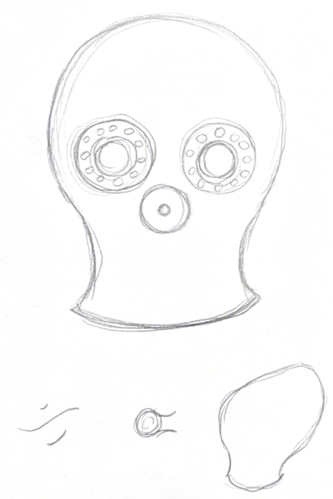 | 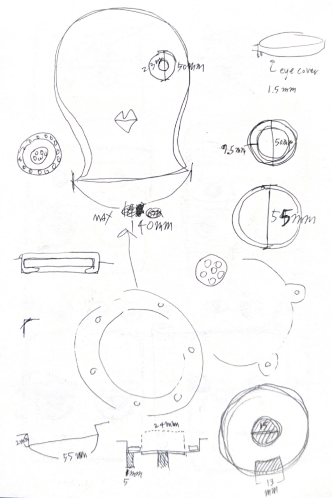 |
| **LED housing and eye-cover assembly** | **Rhino head-shell model** |
| 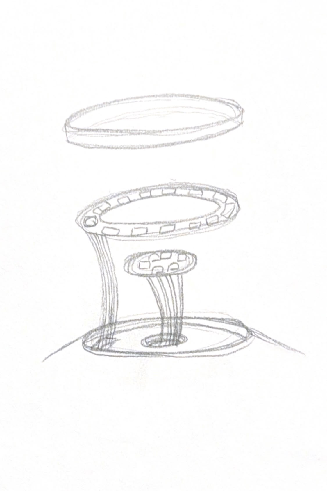 | 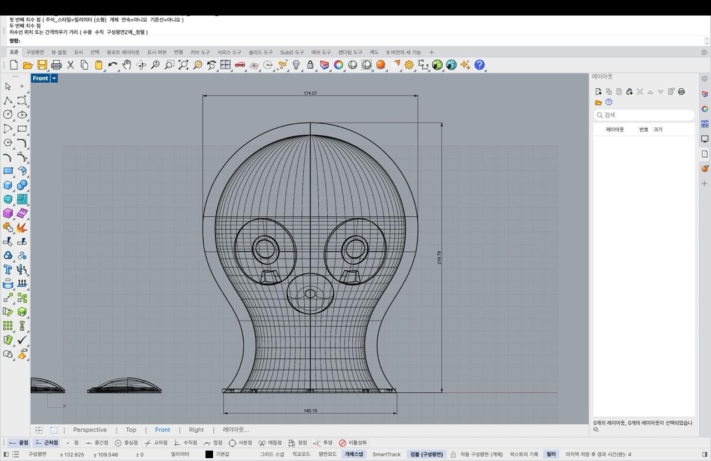 |

Dedicated LED housings were incorporated into the eye areas to position the LED components within the curved shell. The design considered the fit of the components, their alignment, and openings for routing the wires into the head.

Separate eye covers were also designed and fabricated to fit over the LED housings. The head shell, LED mounting areas, and covers were developed together so that the eyes formed an integrated part of the character’s face.

The Rhino model shown above is provided in the repository as [`OCTOPUS HEAD SHELL.3dm`](3D%20File/OCTOPUS%20HEAD%20SHELL.3dm).

<a id="tentacle-paper-prototype"></a>

### 4.2 Tentacle Paper Prototype

We created a paper prototype using a tentacle template from the reference material. By cutting, folding, and assembling the paper structure, we explored how the individual segments worked together. We then tested how pulling a cable caused the tentacle to bend and curl. This allowed us to understand the movement through a simple physical model before applying it to our robot.

| Paper prototype movement test | Cable-pull bending test |
| :---: | :---: |
| 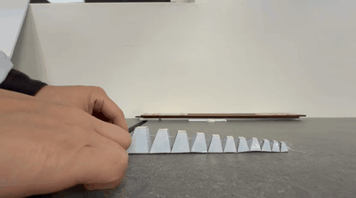 | 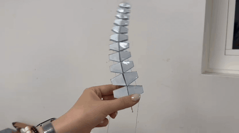 |

Based on these observations, we modified the tentacle’s 3D model to incorporate the same actuation principle. The paper prototype helped us consider the relationship between the segment geometry, cable routing, and bending movement. It served as an initial test model that connected the reference research with the development of our own tentacle design.

<a id="hardware-and-arduino"></a>

## 5. Hardware and Arduino

The laptop sends one CSV line at a time to a single Arduino Nano Every through USB serial. The Nano controls both LED rings and both stepper motors; there is no second Arduino or board-to-board serial link in the current system.

The current sketch uses a 4 ms step interval for Motor 1 and a 3 ms interval for Motor 2. Class 2 moves Motor 1 by 350 steps in one direction, while Class 3 moves it by 230 steps in the opposite direction. Motor 2 performs two cycles of 1,400 steps up and 600 steps down for an accepted result.

Upload `Arduino Code/Nano2_TentacleB_motor_test/Nano2_TentacleB_motor_test.ino` to the Nano Every. Despite the legacy filename, this is the current single-board sketch. Open `Wekinator Project/FlagMatch_AB_4Class/FlagMatch_AB_4Class.wekproj` with the installed Wekinator application, start listening on port 6448, and run the model. Then run `Processing Code/Camera_to_Wekinator_2x25x50/Camera_to_Wekinator_2x25x50.pde`, followed by `Processing Code/processing_osc_to_arduino/processing_osc_to_arduino.pde`. Close Arduino Serial Monitor before starting the Processing bridge because both programs cannot use the same USB serial port simultaneously.

<a id="hardware-components"></a>

### 5.1 Components

The current hardware uses:

- one Arduino Nano Every connected to the laptop by USB;
- two 28BYJ-48 5 V stepper motors, each with its own ULN2003 driver board;
- two 12-LED WS2812B rings;
- one external regulated 5 V supply for the motors and LED rings; and
- one shared ground between the external supply and the Nano.

<a id="arduino-code"></a>

### 5.2 Arduino Code

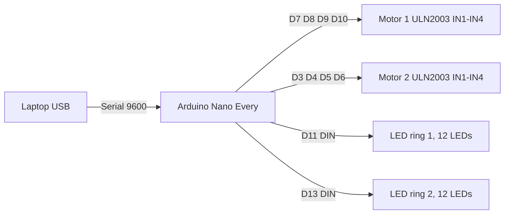

The laptop sends `2,0.9900,0.0100`. That is the class, the best chance, and the next chance.

Class 1 arms or resets the round. Class 2 moves Motor 1 in one direction, Class 3 moves it in the opposite direction, and Class 4 leaves Motor 1 centred. For an accepted result with a top probability of at least 0.4, Motor 2 then performs two up-and-down cycles. A result below 0.4 stops after the unknown gesture without running the final motor action.

The current firmware uses the highest probability directly. Above 0.8, it performs the result action immediately. From 0.6 to 0.8, the eyes complete three laps before the result. From 0.4 to 0.6, the eyes complete five laps while Motor 1 sways slowly. Below 0.4, the robot performs the unknown gesture and does not continue to the result action. For the first three ranges, the rings turn green before the motor action.

The Nano reports its state through the same USB serial connection. Important messages include `WAITING_FOR_ARM`, `ARMED`, `PLACEMENT 4s`, `OBSERVING 2s`, `LOCKED`, `DECISION`, `DONE`, and `CANCELLED false trigger`. Processing uses `LOCKED` and `DONE` to coordinate the round gate.

<a id="wiring"></a>

### 5.3 Wiring

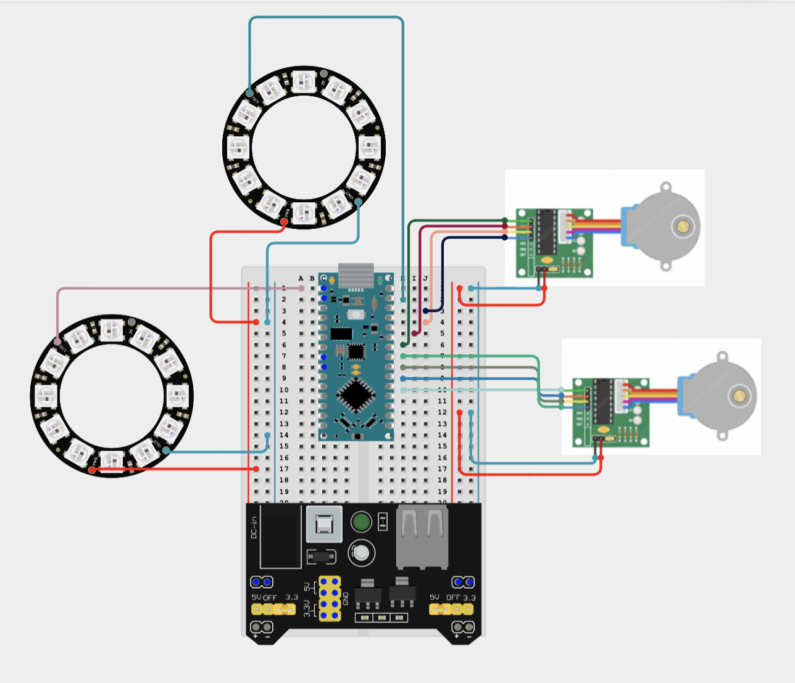

*Figure 5.1. Physical wiring for one Arduino Nano Every, two ULN2003 motor drivers, two stepper motors, and two 12-LED rings.*

Motor 1 uses Nano pins D7, D8, D9, and D10 in ULN2003 IN1-to-IN4 order. Motor 2 uses D3, D4, D5, and D6. Each motor remains connected to its own ULN2003 motor socket; the driver VCC and GND connect to the external 5 V supply.

LED ring 1 receives data on D11 and LED ring 2 receives data on D13. Each ring has 12 WS2812B LEDs. Connect each data wire to `DIN`, not `DOUT`. D13 is also connected to the Nano's onboard LED, so the onboard lamp may flicker when the second ring updates.

The Nano communicates with Processing through its USB serial connection at 9600 baud. Keep Serial Monitor closed while the Processing bridge is running. Connect the Nano ground, both ULN2003 grounds, both LED grounds, and the external-supply ground together.

<a id="power"></a>

### 5.4 Power

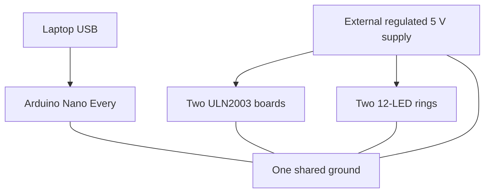

Do not power either motor from the Nano 5 V pin. Use the external 5 V supply for both ULN2003 VCC pins and both LED rings.

The Nano takes power from the laptop USB cable. Tie together the grounds of the supply, Nano, both motor drivers, and both LED rings. Without the shared ground, the motor and LED control signals may not work reliably.

Unplug the motor supply before you upload. A motor loading the USB port makes the upload fail.


<a id="software-design"></a>

## 6. Software Design

The software is divided into camera capture, machine learning, Processing round gating, Arduino result voting, communication, and robot control. Each component can be tested separately.

```text
Camera
  ↓
Processing: crop and downsample two flag images
  ↓  OSC /wek/inputs, port 6448
Wekinator: four-class KNN model
  ↓  OSC /wek/outputs and /Match-Result, port 12000
Processing: Class 1 round gate and serial bridge
  ↓  USB serial, 9600 baud
Arduino: 4 s placement, 2 s voting, confidence and robot control
```

<a id="software-components"></a>

### 6.1 Software Components

| Component | File | Responsibility |
| --- | --- | --- |
| Camera input | `Camera_to_Wekinator_40x30/Camera_to_Wekinator_40x30.pde` | Captures regions A and B and converts them into fixed-size RGB inputs |
| Machine learning | `Wekinator FlagMatch AB.app` and `FlagMatch_AB_4Class/` | Stores the training data and KNN model and predicts the result for each flag pair |
| Arduino bridge | `processing_osc_to_arduino/processing_osc_to_arduino.pde` | Arms each round from Class 1 and forwards live classes and probabilities through serial |
| Robot control | `Arduino Code/Nano2_TentacleB_motor_test/Nano2_TentacleB_motor_test.ino` | Validates serial data and controls two stepper motors and two LED rings |

The bridge without round-state filtering is stored in `processing_osc_to_arduino_backup/`. It can be used to test direct communication between Wekinator and Arduino.

<a id="software-camera-input"></a>

### 6.2 Camera Input and Image Preprocessing


*Figure 6.1. The Processing sketch captures two flag regions and sends 7,500 RGB values to Wekinator through OSC port 6448.*

The camera view contains two horizontal capture regions:

- Region A contains the left flag.
- Region B contains the right flag.
- Both regions use a 2:1 aspect ratio and are not stretched.
- Each region is downsampled to 50 × 25 pixels.
- Each pixel contributes red, green, and blue values.

Each flag produces:

```text
50 × 25 × 3 = 3,750 inputs
```

The two regions are combined into one OSC message:

```text
3,750 + 3,750 = 7,500 inputs
```

Values 1–3,750 belong to region A, and values 3,751–7,500 belong to region B. Wekinator distinguishes the images by their fixed positions in the input array.

<a id="software-communication"></a>

### 6.3 Communication Interfaces

The camera sketch sends image data to Wekinator:

```text
Address: /wek/inputs
Port: 6448
Values: 7,500 floats
```

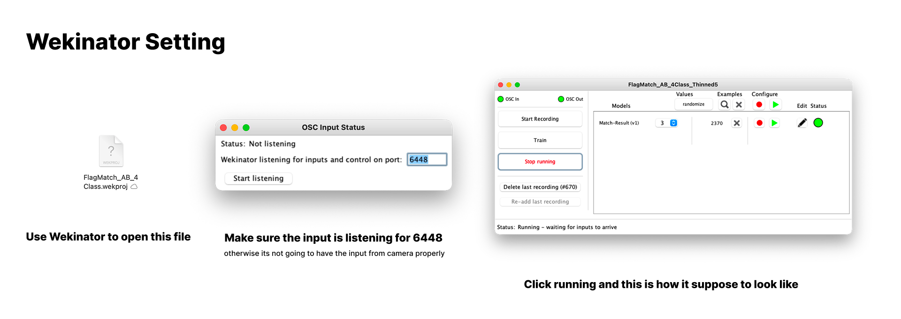

*Figure 6.2. The Wekinator project listens for camera input on port 6448 and runs the four-class model.*

Wekinator returns the predicted class and class probabilities:

```text
/wek/outputs    Predicted class
/Match-Result   Class probabilities
Port: 12000
```

The Processing bridge sends one CSV line to Arduino:

```text
<class>,<top_probability>,<second_probability>
```

For example:

```text
2,0.7426,0.1831
```

This represents Class 2, with a top probability of 0.7426 and a second-place probability of 0.1831. Processing and Arduino both use a baud rate of 9600.

<a id="software-round-filtering"></a>

### 6.4 Round-State Filtering

Wekinator evaluates every camera frame. Small changes in lighting, position, or camera noise can make the predicted class switch between frames. Sending every prediction directly to Arduino could therefore trigger repeated or conflicting movements.

Processing and Arduino divide the round-state sequence as follows:

```text
Processing: Class 1 remains stable for 500 ms
  ↓
Processing sends 1,1.0000,0.0000 and arms the round
  ↓
Class 2–4 is first detected
  ↓
Processing forwards live predictions every 100 ms
  ↓
Arduino waits 4 seconds for flag placement
  ↓
Arduino records Classes 2–4 for 2 seconds
  ↓
Arduino selects the most frequently received class
  ↓
Arduino performs the thinking and result action
  ↓
Arduino sends DONE
  ↓
Processing waits for 3 seconds of stable Class 1 before re-arming
```

During the two-second observation period, Arduino counts the occurrences of Classes 2–4. The class with the most votes becomes the final result; if two classes have equal votes, the latest observed class wins the tie. Arduino also averages the transmitted top and second probabilities from samples associated with the winning class.

Processing continues forwarding predictions while the round is active so Arduino can observe the changing result and detect a false trigger. If Class 1 persists for three seconds during placement, observation, or an unfinished action, Arduino cancels the round. After Arduino sends `DONE`, Processing waits for three seconds of stable Class 1, sends the reset command, and enables the next round.

<a id="software-arduino"></a>

### 6.5 Arduino Command Handling

Arduino validates every CSV message before using it. During the observation window, it votes on Classes 2–4 and averages the two transmitted probability values for the winning class. The winning class selects the final action.

The thinking behaviour is selected from the averaged top probability: above 0.8 is a direct result; 0.6–0.8 produces three eye laps; 0.4–0.6 produces five eye laps with a slow Motor 1 sway; and below 0.4 produces the unknown gesture without a final result action. The second probability is retained for logging but is not currently used to select the confidence range.

From the first Class 2–4 prediction, the fixed decision period is approximately six seconds: four seconds for placement followed by two seconds of observation. Thinking and motor movements add variable time after that decision. The separate three-second Class 1 period is used to cancel a false trigger or re-arm the next round; it is not an extra delay before every result.

<a id="machine-learning"></a>

## 7. Machine Learning

<a id="ml-task"></a>

### 7.1 Classification Task

The project uses a four-class classifier:

| Class | Label |
| --- | --- |
| 1 | Nothing / empty board |
| 2 | A beats B |
| 3 | B beats A |
| 4 | Draw |

The model maps a pair of flag images directly to a match result. It does not identify each country separately or query an external football database.

For matches with a winner, both left-right arrangements are recorded. If the winning flag is in region A, the sample is labelled Class 2. After swapping the flags, it is labelled Class 3. A draw remains Class 4 in both arrangements.

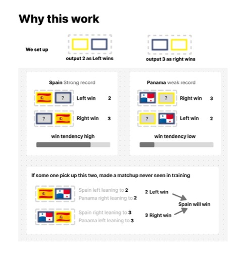

*Figure 7.1. The same flag contributes to Class 2 or Class 3 depending on whether it appears on the left or right, allowing the model to infer previously unseen pairings.*

<a id="ml-training-data"></a>

### 7.2 Training Data

Before collecting the full dataset, we trained a small demo model using a limited set of known matchups. We then tested it with a flag pairing that had not appeared in the demo training set. The model followed the expected left-right winner structure, confirming that the proposed image-classification approach was viable before full-scale data collection.


*Figure 7.2. The initial demo verified the camera input, class structure, and ability to generalise the winner direction to an unseen flag pairing.*

When `Start Recording` is active, every captured frame becomes an independent training example. Each recording session contains about 30 frames, with a possible difference of one or two frames because recording is stopped manually.

Using a similar number of frames for each matchup prevents one recorded matchup from contributing much more data than another. To reduce near-duplicate static frames, each block of approximately 30 examples was later reduced to five representative examples. The classes remain imbalanced because the source match records contain different numbers of wins and draws.


*Figure 7.3. Match records were converted into left-win, right-win, and draw labels for the flag-pair training data.*

The reduced dataset contains 2,370 examples:

| Class | Examples |
| --- | ---: |
| Class 1 | 30 |
| Class 2 | 971 |
| Class 3 | 992 |
| Class 4 | 377 |
| **Total** | **2,370** |

Recording a static scene still produces very similar examples. More useful variation comes from changes in:

- flag position;
- camera distance;
- lighting and screen illumination;
- background and shadows.

Both flags should remain fully inside their capture regions.

<a id="ml-model"></a>

### 7.3 KNN Model

Wekinator uses a K-Nearest Neighbours classifier:

```text
K = 17
```

The model finds the 17 closest training examples and predicts one of Classes 1–4 from their labels.

A single recording originally produced about 30 highly similar frames. After retaining five representative examples from each block, `K = 17` allows the neighbourhood to extend beyond one retained recording block while remaining sensitive to visually similar flag pairs.

The value of K can reduce the influence of one small cluster, but it cannot correct class imbalance or missing lighting and position variations. Frame-level instability is therefore handled separately by the Processing round-state filter.

<a id="ml-probabilities"></a>

### 7.4 Interpreting Class Probabilities

Wekinator's class probabilities are based on the labels of nearby KNN examples. They are not calibrated probabilities and should not be interpreted as the real-world chance of a team winning.

For an identical input, KNN should return the same result. If the probability changes while the scene appears still, the pixel values are usually changing because of camera noise, automatic exposure, shadows, or small movements. The model does not accumulate confidence over time.

The total number of examples in a class also does not guarantee that the class will win a prediction. KNN mainly depends on the examples closest to the current input.

Frame-level predictions are stabilised by Processing rather than by the model itself. See [Round-State Filtering](#software-round-filtering) for the complete timing and decision logic.

<a id="final"></a>

## 8. Final Outcome & Demonstration

[Watch the final outcome demonstration (MP4)](Image/Outcome.mp4)

The final outcome is an interactive octopus robot inspired by Paul the Octopus. It combines a rounded head shell, LED eyes, articulated tentacles, and a blue display base. Together, these elements create a character that communicates its decisions through light and movement.

The interaction begins when a user places two football flag cards in the camera’s left and right capture regions. The system allows four seconds for positioning, then collects classification results for two seconds. The most frequently received class determines the response: a left-side win, a right-side win, or a draw.

The octopus expresses different levels of certainty through its LED eyes and motor movements. A high-confidence classification leads directly to the result action, while lower confidence produces a longer thinking sequence with eye animations and swaying movements. When confidence is too low, the robot displays an uncertain expression without performing a final result action. These behaviours give the classification process a visible personality.

During development and demonstration, mechanical resistance limited the intended tentacle movements, and power-related difficulties affected operation. A simplified two-motor approach was developed around base rotation and a nodding movement to communicate the result. The prototype brought camera input, machine-learning classification, LED expressions, and motor control together in an interactive physical character.

<a id="ml-limitations"></a>

## 9. Limitations and Future Improvements

### 9.1 Mechanical Limitations

The intended design uses six stepper motors, with three motors controlling each tentacle. The first motor rotates the base, allowing the tentacle to point in different horizontal directions. The second motor pulls a cable routed through most of the tentacle segments, controlling the overall bending direction. The third motor operates a separate cable connected to the tip segments, enabling the end of the tentacle to move independently.

Together, these three motors would allow each tentacle to move in multiple directions while controlling its main body and tip separately. The prototype demonstrated that this actuation principle was possible. However, the 3D-printed tentacles were relatively heavy and produced considerable friction between their segments. Combined with the limited motor torque and power available, this prevented the tentacles from achieving the fast and expressive movements originally intended.

Because of the available development time, only one tentacle was brought to a functional movement stage. The intended final system would apply the same three-motor mechanism to both tentacles, allowing each side to move independently.

### 9.2 Electronics and Power Limitations

An Arduino Nano Every was selected because the components had been ordered in advance, but additional hardware did not arrive before the final assembly period. A single Nano Every has limited digital I/O for controlling six four-wire stepper-motor drivers alongside the LED components.

A larger Arduino board with more digital pins could control all six motors from one controller. Alternatively, two Nano Every boards could divide the motors between the two tentacles. In either arrangement, the motors would require adequately rated external power supplies and driver boards, with a shared ground between the controllers and motor-power system.

### 9.3 Future Improvements

Future development would focus on reducing the weight and resistance of the tentacles. The printed segments could use thinner walls, more hollow internal structures, lighter materials, or improved joints to reduce the force required from the motors. Alternative segmented structures, including finger-like joint mechanisms, could also provide smoother and more predictable bending.

The electronics could be improved through a larger controller or a coordinated two-board system, more suitable motor drivers, and a dedicated power supply capable of operating all six motors reliably. With these improvements, both tentacles could achieve the intended multidirectional and independently segmented movement.

Despite the mechanical, electrical, and time constraints, the prototype successfully demonstrated the core cable-driven actuation concept. It provides a functional foundation for a lighter, more powerful, and more expressive future version of the robot.
